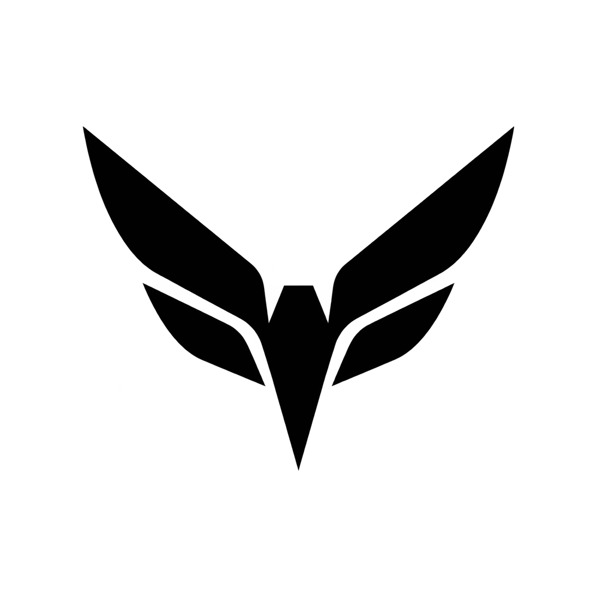
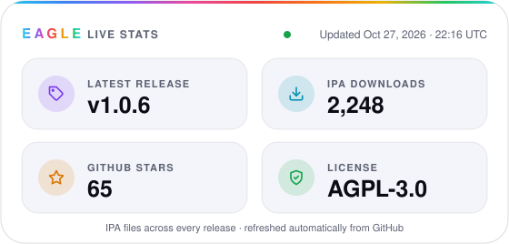

<div align="center">
  <picture>
    <source media="(prefers-color-scheme: dark)" srcset="lara/other/media.xcassets/AppIcon.appiconset/Eagle-Dark.png">
    
  </picture>

  # Eagle

  **Eagle is an iPhone personalization utility for compatible iOS versions.**

  It lets experienced sideloading users customize wallpapers, passcode keys,
  supported Wallet cards, Home Screen elements, Dynamic Island and Dock lighting
  from one app. Private system operations require careful compatibility checks.

  <!-- eagle-stats:start -->
  <a href="https://github.com/leonardob8777-bit/Eagle/releases">
    <picture>
      <source media="(prefers-color-scheme: dark)" srcset="docs/badges/stats-dark.svg">
      
    </picture>
  </a>

  <br><br>

  <a href="https://github.com/leonardob8777-bit/Eagle/releases/download/v1.0.6/Eagle-1.0.6-95.ipa">
    
  </a>

  <br><br>

  [Release notes](https://github.com/leonardob8777-bit/Eagle/releases/tag/v1.0.6)
  · [Star Eagle](https://github.com/leonardob8777-bit/Eagle/stargazers)
  · [Report a bug](https://github.com/leonardob8777-bit/Eagle/issues/new?template=bug_report.md)
  · [Request a feature](https://github.com/leonardob8777-bit/Eagle/issues/new?template=feature_request.md)
  <!-- eagle-stats:end -->

  <sub>Sign the IPA with your usual personal-device installation method.</sub>
</div>

---

## At a glance

| | |
|---|---|
| **Current release** | Eagle 1.0.6 · build 95 |
| **Languages** | English · Español · 简体中文 |
| **Primarily verified on** | iPhone 16 Pro (`iPhone17,1`) · iOS 18.6.2 (`22G100`) |
| **Architecture** | `arm64e` |
| **Verified Aura surfaces** | Dynamic Island, Dock and current-page icon glow/outline · isolated apply and verification |
| **Project status** | Stable release · test one change at a time |

> [!WARNING]
> Eagle uses kernel-level and private SpringBoard capabilities. An incompatible
> operation can respring or reboot the device. Back up important data, test one
> change at a time and do not treat this as a production-safe utility.

## What Eagle includes

| Experience | What it does |
|---|---|
| 🎨 **Styles** | Coordinates wallpaper, passcode and Wallet-card experiences. |
| 🌌 **Wallpapers** | Browses community packs, imports compatible packages and converts short videos for Pocket Poster. |
| 💳 **Cards** | Previews, applies, backs up and restores supported Wallet card artwork. |
| 🔢 **Passcode** | Browses, imports, previews, applies and restores compatible key themes. |
| 🧩 **Icon Studio · Coming soon** | Temporarily unavailable while theme importing and custom shapes are validated. |
| 📱 **Dock** | Provides layouts supporting up to six apps where SpringBoard accepts them. |
| ✨ **Aura Studio** | Applies independently colored Dynamic Island and Dock lighting, manages the system Island and Dock background, and keeps verified surface state isolated. |
| 🖼️ **Island Gallery** | Offers curated Live and Static artwork, Saves, adjustable shadow and precise placement. |
| 🌈 **Dock Gallery** | Places static and Live artwork behind Dock apps, with Saves, adjustable glow and precise placement. |
| 🔤 **App Name Color · Advanced** | Applies a page-owned solid color to app names on the current Home Screen page. |
| 🛡️ **Eagle System** | Adds Guardian checks, Scenes and shareable personalization recipes. |

### New in Eagle 1.0.6

- **简体中文:** Simplified Chinese joins English and Spanish, with language changes applied immediately.
- **A new opening:** monochrome Eagle icon, animated logo launch and a circular transition from the welcome screen.
- **Actions within reach:** fixed bottom Prepare/Apply bars across customization screens; previews and saving stay in the page.
- **31 new Dock backgrounds:** 18 Static and 13 Live additions to the online gallery.
- **Clearer controls:** readable text over gradients, solid secondary buttons, legible disabled labels and switches that remain visible and unclipped in light and dark mode.
- **Smoother feedback:** refined tab transitions, touch feedback and Prepare progress, with hidden background animations paused.

Read the [complete release notes](docs/releases/v1.0.6.md), including verification and known visual limitations. This update does not expand iOS compatibility.

### Aura Studio safety model

- Dynamic Island and Dock are isolated operations: one surface is never marked
  active merely because the other succeeded.
- Rainbow is available for Dynamic Island. Dock Rainbow remains disabled because
  it has not been proven reliable on a physical device.
- Home Icon Neon is initially allowlisted for iPhone 16 Pro (`iPhone17,1`) on
  iOS 18.6.2 (`22G100`) and applies a one-time snapshot page by page.
- A failed verification keeps the safety lock closed and does not trigger an
  automatic respring.
- Aura overlays may disappear after a SpringBoard respring or device reboot and
  must then be applied again.

## Install Eagle

1. Use the **Download Eagle** button at the top of this page.
2. Sign the IPA with your preferred personal-device sideloading method.
3. Install it and open Eagle manually from the Home Screen.
4. If you installed through Xcode, press **Stop** before preparing Eagle access.
5. Apply one feature at a time and keep the exact result message if something fails.

Looking for an older build? Browse [all Eagle releases](https://github.com/leonardob8777-bit/Eagle/releases).

## Compatibility and current limits

- **Prepare support:** iOS 16.x has limited testing (16.7.2 is the verified limited route);
  iOS 17.0–18.7.1 and 26.0–26.0.1 are accepted.
- Unverified iOS 16 builds, releases outside the supported ranges above and
  current MIE devices are blocked.
- iPhone 16 (`iPhone17,3`) running iOS 18.5 follows the supported Prepare route.
- Aura Studio live changes remain limited to verified iOS 17/18 SpringBoard routes.
- If Island Aura reports **Safe Compact Halo**, it will not expand with music,
  screen recording or timers. Only **Adaptive Aura** follows those layouts.
- Screen, Battery Halo and Lock experiments are hidden while their live
  SpringBoard hosts remain unverified.
- Dock and Dynamic Island Aura include dedicated geometry for iPhone 14 Pro,
  iPhone 14 Pro Max and the primary iPhone 16 Pro reference profile. Other
  supported models may still require model-specific validation.
- Icon importing, nonstandard masks and community packages remain dependent on
  device, iOS version and package structure.
- Kernel or SpringBoard operations are intentionally blocked while the Xcode
  debugger is attached.

Device strings such as `iPhone15,2` are Apple's technical model identifiers
(`iPhone15,2` is an iPhone 14 Pro), not the marketing generation number.

## Build from source

Requirements:

- macOS with Xcode
- the `codesign` tool included with macOS/Xcode

Compile without installing on a device:

```sh
xcodebuild -project lara.xcodeproj \
  -scheme lara \
  -configuration Debug \
  -destination 'generic/platform=iOS' \
  CODE_SIGNING_ALLOWED=NO build
```

Package the release IPA:

```sh
./scripts/build_ipa.sh
```

The result is written to `build/Eagle.ipa`.

## Report a problem

Open the [guided bug report](https://github.com/leonardob8777-bit/Eagle/issues/new?template=bug_report.md)
and include:

- exact iPhone or iPad model;
- iOS version and build number;
- Eagle version or commit;
- feature and selected mode;
- exact result message;
- the shareable Prepare or Aura diagnostic report when Eagle offers one;
- a full-width screenshot when the problem is visual;
- the relevant end of `Documents/lara.log`, with personal paths removed.

Do not publish tokens, certificates, provisioning profiles or unrelated personal files.

## Project lineage, license and acknowledgements

Eagle is a modified version of [Lara](https://github.com/rooootdev/lara). The
Eagle interface and feature set began diverging from Lara in August 2026.

Eagle is licensed as a whole under [GNU AGPL-3.0](LICENSE), preserving Lara's
license and notices. Source distributions and modified builds must continue to
comply with that license.

Core acknowledgements include the Lara contributors, rooootdev, opa334, ChOma,
XPF, AlfieCG/libgrabkernel2, DarkSword contributors, AppInstaller iOS and the
upstream projects whose notices remain in [`lara/licenses`](lara/licenses).
Portions of Eagle's OTA implementation are adapted from
[Cyanide](https://github.com/0xjohnnydev/cyanide) by
[0xjohnny](https://github.com/0xjohnnydev) (formerly zeroxjf), first published
in May 2026 under AGPL-3.0 and inherited by Eagle through Lara. See the
[Cyanide OTA notice](lara/licenses/NOTICE_Cyanide_OTA.md) for provenance links.
Eagle's on-device PosterBoard descriptor import bridge is adapted from
[Pocket Poster](https://github.com/leminlimez/Pocket-Poster) by leminlimez,
published under GPL-3.0. See the
[Pocket Poster notice](lara/licenses/NOTICE_Pocket_Poster.md) for the exact
upstream files and license links.
See Lara's [contributor history](https://github.com/rooootdev/lara/graphs/contributors)
for the complete upstream record.

---

<div align="center">
  <strong>Eagle</strong> · precise customization, explicit verification
  <br>
  <sub>Built with Swift, SwiftUI and DarkSword.</sub>
</div>
